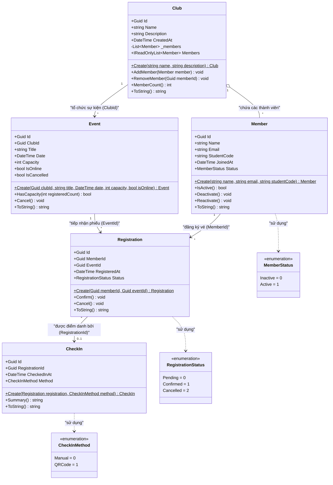

# 🎓 EDUHUB — HỆ THỐNG QUẢN LÝ CÂU LẠC BỘ & SỰ KIỆN SINH VIÊN

[](https://dotnet.microsoft.com/)
[](https://docs.microsoft.com/dotnet/csharp/)
[]()
[]()

## 📌 THÔNG TIN HỌC PHẦN & SINH VIÊN
* **Học phần:** Phát triển phần mềm hướng đối tượng (Mã HP: **IN4221** / IN4211)
* **Khoa / Trường:** Khoa Công nghệ và Kỹ thuật — **Trường Đại học Đồng Tháp**
* **Giảng viên hướng dẫn:** **ThS. Nguyễn Tuấn Kiệt**
* **Sinh viên thực hiện:** **Phan Trần Gia Hưng**
* **Mã số sinh viên (MSSV):** **`0024417689`**
* **Lớp sinh hoạt:** **DHCNTT24B** (hoặc DHCNTT24A)
* **Chủ đề bài tập:** Bài tập Chương 1 (Slide trang 34) — Xây dựng bộ User Stories cho dự án EduHub & Hiện thực hóa mô hình lớp hướng đối tượng (Domain Model)

---

## 📖 1. TỔNG QUAN BÀI LÀM

Thực hiện yêu cầu bài tập tại **Slide bài giảng Chương 1 (trang 34)**:
> *"Tự viết ít nhất 5 story, đủ 3 vai trò. Đừng chép story mẫu!"*

Bộ User Stories trong dự án này được xây dựng **độc lập 100%**, không sao chép lại các story mẫu trên slide giảng viên, đảm bảo bao phủ đầy đủ **3 tác nhân (Actors)** chính trong hệ sinh thái EduHub:
1. 👤 **Sinh viên / Thành viên CLB (Member)**
2. 🧑‍💼 **Ban chủ nhiệm Câu lạc bộ (Club Admin)**
3. 🛠 **Quản trị viên hệ thống (System Admin)**

Toàn bộ các User Stories đều được chuẩn hóa theo tiêu chí nghiệm thu **Acceptance Criteria (Gherkin: Given - When - Then)** và được hiện thực hóa trực tiếp thành mã nguồn C# (.NET 10) tuân thủ nghiêm ngặt các quy chuẩn lập trình hướng đối tượng (OOP Invariants & Encapsulation).

---

## 📊 2. BẢNG TỔNG HỢP 6 USER STORIES CHO 3 VAI TRÒ

| STT | Mã Story | Tác nhân (Actor) | Tính năng nghiệp vụ | Tóm tắt mục đích & Giá trị nghiệp vụ |
| :---: | :---: | :--- | :--- | :--- |
| **1** | **US-NEW-01** | 👤 Sinh viên (Member) | Hủy phiếu đăng ký sự kiện | Sinh viên bận đột xuất muốn hủy phiếu trước giờ G để nhường suất tham dự cho người khác. |
| **2** | **US-NEW-02** | 👤 Sinh viên (Member) | Rút tên khỏi Câu lạc bộ | Thành viên chủ động rời CLB khi không còn thời gian sinh hoạt, cập nhật lại sĩ số chính thức. |
| **3** | **US-NEW-03** | 🧑‍💼 Ban CLB (Club Admin) | Hủy bỏ sự kiện đã lên lịch | Ban tổ chức hủy sự kiện do sự cố bất khả kháng, tự động chuyển toàn bộ phiếu sang Cancelled. |
| **4** | **US-NEW-04** | 🧑‍💼 Ban CLB (Club Admin) | Duyệt phiếu theo sức chứa | Xác nhận hàng loạt phiếu Pending trong giới hạn Capacity còn lại của sự kiện, chặn vượt chỉ tiêu. |
| **5** | **US-NEW-05** | 🛠 Quản trị viên (Admin) | Phê duyệt thành lập CLB mới | Khởi tạo tổ chức CLB mới với kiểm tra toàn vẹn định danh (Name không rỗng, Id GUID duy nhất). |
| **6** | **US-NEW-06** | 🛠 Quản trị viên (Admin) | Khôi phục thành viên (Reactivate) | Kích hoạt lại tài khoản thành viên từ Inactive sang Active sau khi hoàn thành thủ tục kỷ luật. |

---

## 📝 3. ĐẶC TẢ CHI TIẾT USER STORIES & TIÊU CHÍ NGHIỆM THU

### 👤 3.1 Nhóm tác nhân Sinh viên (Bố cục Slide 32)

#### 🔹 **US-NEW-01 · Sinh viên: Hủy phiếu đăng ký tham gia sự kiện**
* **User Story:**
  > *"Là một **Sinh viên**, tôi muốn **hủy phiếu đăng ký tham gia sự kiện** của mình trước giờ diễn ra, để **nhường lại cơ hội và suất tham dự cho các bạn sinh viên khác**."*
* **Tiêu chí nghiệm thu (Acceptance Criteria):**
  * **AC-01.1 (Hủy hợp lệ):**
    * **Given:** Sinh viên có phiếu đăng ký ở trạng thái `Pending` hoặc `Confirmed`.
    * **When:** Sinh viên gọi phương thức `registration.Cancel()`.
    * **Then:** Trạng thái chuyển thành `Cancelled`, số chỗ trống khả dụng của sự kiện được hoàn lại (+1 chỗ).
  * **AC-01.2 (Chặn hủy bất hợp lệ):**
    * **Given:** Phiếu đăng ký đã điểm danh (`CheckIn`) hoặc đã bị hủy (`Cancelled`) trước đó.
    * **When:** Sinh viên cố gắng gọi `registration.Cancel()`.
    * **Then:** Hệ thống từ chối và ném ra ngoại lệ `InvalidOperationException("Phiếu đăng ký này đã bị hủy trước đó.")`.

#### 🔹 **US-NEW-02 · Sinh viên: Rút tên khỏi Câu lạc bộ**
* **User Story:**
  > *"Là một **Thành viên CLB**, tôi muốn **rút tên khỏi danh sách câu lạc bộ**, để **cập nhật lại sĩ số chính thức và ngưng sinh hoạt**."*
* **Tiêu chí nghiệm thu (Acceptance Criteria):**
  * **AC-02.1 (Rút tên thành công):**
    * **Given:** Sinh viên đang là thành viên chính thức trong `club.Members`.
    * **When:** Sinh viên gọi lệnh `club.RemoveMember(memberId)`.
    * **Then:** Sinh viên bị xóa khỏi danh sách CLB, sĩ số `club.MemberCount()` giảm 1.
  * **AC-02.2 (Chặn rút tên khi không phải thành viên):**
    * **Given:** Sinh viên không tồn tại trong danh sách CLB.
    * **When:** Gọi `club.RemoveMember(memberId)`.
    * **Then:** Báo lỗi ngoại lệ `InvalidOperationException("Sinh viên này hiện không phải là thành viên của CLB.")`.

---

### 🧑‍💼 3.2 Nhóm tác nhân Ban chủ nhiệm CLB & Quản trị viên (Bố cục Slide 33)

#### 🔹 **US-NEW-03 · Ban CLB: Hủy bỏ sự kiện đã lên lịch**
* **User Story:**
  > *"Là **Ban chủ nhiệm CLB**, tôi muốn **hủy bỏ sự kiện đã lên lịch khi có sự cố bất khả kháng**, để **hệ thống tự động thông báo và hủy mọi phiếu đăng ký liên quan**."*
* **Tiêu chí nghiệm thu (Acceptance Criteria):**
  * **AC-03.1 (Hủy sự kiện chưa diễn ra):**
    * **Given:** Sự kiện chưa đến ngày tổ chức (`DateTime.UtcNow <= Date`) và chưa bị hủy.
    * **When:** Ban chủ nhiệm gọi `event.Cancel()`.
    * **Then:** Cờ `IsCancelled = true`, toàn bộ phiếu đăng ký chuyển thành `Cancelled`.
  * **AC-03.2 (Chặn hủy sự kiện quá khứ):**
    * **Given:** Sự kiện đã qua ngày tổ chức hoặc đã bị hủy trước đó.
    * **When:** Ban chủ nhiệm gọi `event.Cancel()`.
    * **Then:** Bị từ chối và ném ra `InvalidOperationException`.

#### 🔹 **US-NEW-04 · Ban CLB: Duyệt phiếu đăng ký theo sức chứa (Capacity)**
* **User Story:**
  > *"Là **Ban chủ nhiệm CLB**, tôi muốn **duyệt các phiếu đăng ký Pending trong giới hạn sức chứa**, để **đảm bảo số lượng người tham dự không vượt quá chỉ tiêu phòng họp**."*
* **Tiêu chí nghiệm thu (Acceptance Criteria):**
  * **AC-04.1 (Duyệt khi còn chỗ):**
    * **Given:** Sự kiện còn chỗ trống (`HasCapacity(registeredCount) == true`).
    * **When:** Ban tổ chức gọi `registration.Confirm()`.
    * **Then:** Phiếu chuyển trạng thái thành `Confirmed`.
  * **AC-04.2 (Chặn khi đủ sức chứa):**
    * **Given:** Số phiếu đã đạt giới hạn `Capacity`.
    * **When:** Ban tổ chức duyệt thêm phiếu mới.
    * **Then:** Hệ thống từ chối duyệt, giữ nguyên trạng thái `Pending`.

#### 🔹 **US-NEW-05 · Admin: Phê duyệt thành lập CLB mới**
* **User Story:**
  > *"Là **Quản trị viên**, tôi muốn **phê duyệt khởi tạo Câu lạc bộ mới**, để **sinh viên có môi trường sinh hoạt học thuật chính quy**."*
* **Tiêu chí nghiệm thu (Acceptance Criteria):**
  * **AC-05.1 (Khởi tạo CLB hợp lệ):**
    * **Given:** Tên CLB không rỗng.
    * **When:** Admin gọi `Club.Create(name, description)`.
    * **Then:** Đối tượng `Club` mới được khởi tạo với `Id` dạng GUID duy nhất và danh sách thành viên rỗng.
  * **AC-05.2 (Chặn tên rỗng):**
    * **Given:** Tên CLB để trống hoặc chỉ có khoảng trắng.
    * **When:** Gọi `Club.Create("", ...)`.
    * **Then:** Ném ra lỗi ngoại lệ `ArgumentException("Tên câu lạc bộ không được để trống.")`.

#### 🔹 **US-NEW-06 · Admin: Khôi phục hoạt động cho thành viên (Reactivate)**
* **User Story:**
  > *"Là **Quản trị viên**, tôi muốn **kích hoạt lại tài khoản thành viên**, để **họ tiếp tục sinh hoạt sau khi hoàn tất thủ tục kỷ luật**."*
* **Tiêu chí nghiệm thu (Acceptance Criteria):**
  * **AC-06.1 (Kích hoạt lại tài khoản Inactive):**
    * **Given:** Thành viên đang ở trạng thái `MemberStatus.Inactive`.
    * **When:** Admin gọi `member.Reactivate()`.
    * **Then:** Trạng thái chuyển thành `MemberStatus.Active`, `IsActive() == true`.
  * **AC-06.2 (Thành viên đang Active):**
    * **Given:** Thành viên đang hoạt động bình thường (`Active`).
    * **When:** Admin gọi `member.Reactivate()`.
    * **Then:** Trạng thái duy trì `Active`.

---

## 🖼️ 4. HÌNH 1: SƠ ĐỒ LỚP HƯỚNG ĐỐI TƯỢNG (DOMAIN CLASS DIAGRAM)

Dưới đây là sơ đồ lớp kiến trúc thực thể miền nghiệp vụ (**Domain Model Class Diagram**) của hệ thống EduHub, được biểu diễn bằng Mermaid:



> **Ghi chú về quan hệ thiết kế OOP:**
> * `Club o-- Member`: Quan hệ chứa (Aggregation). Một CLB quản lý tập hợp `_members`, đóng gói bằng `IReadOnlyList<Member>`.
> * `Club --> Event`: Quan hệ 1-Nhiều thông qua khóa ngoại `ClubId` trong `Event`.
> * `Member --> Registration` & `Event --> Registration`: Quan hệ đăng ký nhiều-nhiều gián tiếp thông qua thực thể liên kết `Registration` (chứa `MemberId` và `EventId`).
> * `Registration --> CheckIn`: Quan hệ 1-1 / 1-0..1, một phiếu đăng ký chỉ được điểm danh tối đa 1 lần thông qua khóa ngoại `RegistrationId`.

---

## 🏛️ 5. CÁC NGUYÊN TẮC THIẾT KẾ & ĐÓNG GÓI HƯỚNG ĐỐI TƯỢNG

Dự án áp dụng chặt chẽ các quy chuẩn thiết kế OOP bắt buộc:
1. **Đóng gói thuộc tính (Encapsulation):** Tất cả các thuộc tính đều có `{ get; private set; }`, không cho phép sửa đổi tùy tiện từ bên ngoài.
2. **Khởi tạo đối tượng an toàn (Factory Method Pattern):** Constructor là `private`, chỉ cho phép tạo đối tượng qua phương thức tĩnh `Create(...)` có tích hợp kiểm tra ràng buộc bất biến (**Invariant Validation**).
3. **Bảo vệ tập hợp dữ liệu (Collection Encapsulation):** `_members` trong `Club` là `private readonly List<Member>`, chỉ cung cấp ra ngoài dưới dạng `IReadOnlyList<Member>`. Việc thêm/xóa thành viên phải qua `AddMember()` và `RemoveMember()` để kiểm tra trùng lặp.
4. **Kiểu dữ liệu trạng thái rõ ràng (Type Safety):** Dùng `enum` tường minh (`MemberStatus`, `RegistrationStatus`, `CheckInMethod`) thay vì chuỗi string.
5. **Đầy đủ khóa ngoại định danh (Foreign Key References):** Các thực thể con đều lưu giữ `Guid` tham chiếu về thực thể cha (`ClubId`, `MemberId`, `EventId`, `RegistrationId`).

---

## 🗂️ 6. CẤU TRÚC THƯ MỤC DỰ ÁN

```text
IN4221_PTPMHDT/
├── docs/                                    # Tài liệu đặc tả và quy chuẩn
│   ├── BO_USER_STORIES.docx                 # Bảng biểu User Stories hoàn chỉnh
│   ├── BO_USER_STORIES_MOI_CHO_EDUHUB.docx  # Bảng biểu chi tiết theo mẫu
│   ├── USER_STORIES_TRANG_34_EDUHUB.md      # Đặc tả User Stories dạng Markdown
│   └── CODING_RULES_IN4211.md               # Quy chuẩn lập trình bắt buộc
├── EduHub.Domain/                           # Domain Model Layer (Entities & Invariants)
│   ├── Club.cs                              # Thực thể Câu lạc bộ
│   ├── Member.cs                            # Thực thể Thành viên
│   ├── Event.cs                             # Thực thể Sự kiện
│   ├── Registration.cs                      # Thực thể Phiếu đăng ký
│   ├── CheckIn.cs                           # Thực thể Bản ghi điểm danh
│   ├── Enums.cs                             # Định nghĩa các Enum trạng thái
│   └── EduHub.Domain.csproj                 # Class Library .NET 10
├── EduHub.Console/                          # Presentation / Demo Console App
│   ├── Program.cs                           # Kịch bản 8 bước nghiệp vụ & kiểm thử Exception
│   └── EduHub.Console.csproj                # Console Application .NET 10
├── EduHub.sln                               # Visual Studio Solution (.NET 10)
├── .gitignore                               # File loại trừ các thư mục rác (bin, obj, .vs)
└── README.md                                # Báo cáo tổng quan dự án (file này)
```

---

## 🚀 7. HƯỚNG DẪN BIÊN DỊCH VÀ CHẠY DỰ ÁN

### Yêu cầu môi trường
* **.NET SDK 10.0** (hoặc .NET 8.0/9.0 tương thích)
* Git

### Các lệnh thực thi

1. **Khôi phục thư viện & Biên dịch toàn bộ Solution:**
   ```bash
   dotnet build EduHub.sln
   ```

2. **Chạy chương trình Console Demo:**
   ```bash
   dotnet run --project EduHub.Console
   ```

---

## 💻 8. KẾT QUẢ CHẠY THỰC TẾ CỦA CHƯƠNG TRÌNH DEMO

Chương trình `EduHub.Console/Program.cs` mô phỏng đầy đủ luồng nghiệp vụ 8 bước thực tế và 4 ca kiểm thử ngoại lệ:

```text
==========================================================================
 🎓 HỆ THỐNG QUẢN LÝ CÂU LẠC BỘ & SỰ KIỆN SINH VIÊN (EDUHUB - CHƯƠNG 01)
 Học phần: Phát triển phần mềm hướng đối tượng (IN4211) — .NET 10
 Sinh viên: Phan Trần Gia Hưng (MSSV: 0024417689)
==========================================================================

[BƯỚC 1] Khởi tạo Câu lạc bộ mới:
  -> Tạo thành công: CLB Tin Học DThU (ID: ca896fdd-345f-465f-bf36-64ecced94417)

[BƯỚC 2] Đăng ký thành viên tham gia CLB:
  -> Đã thêm 2 thành viên vào CLB. Sĩ số hiện tại: 2

[BƯỚC 3] Ban chủ nhiệm tạo Sự kiện mới:
  -> Sự kiện: 'Workshop Clean Architecture với .NET 10' | Sức chứa tối đa: 2 | Hình thức: Online

[BƯỚC 4] Sinh viên đăng ký tham gia sự kiện:
  -> Phan Trần Gia Hưng đăng ký thành công (Mã phiếu: 3b21c843570f45b3a715e09fa7c7f88e, Trạng thái: Pending)
  -> Nguyễn Tấn Lộc đăng ký thành công (Mã phiếu: cb3ddbccfbe149618e38a9ecbd41e57e, Trạng thái: Pending)

[BƯỚC 5] Ban tổ chức duyệt xác nhận phiếu đăng ký:
  -> Phiếu của Phan Trần Gia Hưng đã được chuyển sang: Confirmed

[BƯỚC 6] Sinh viên quét mã QR điểm danh ngày diễn ra sự kiện:
  -> CheckIn: a945c195dff24733a37ba123daeaf441 | Phiếu: 3b21c843570f45b3a715e09fa7c7f88e | Lúc: 00:53:03 14/10/2026 | Phương thức: QRCode

[BƯỚC 7] Báo cáo thống kê tham dự sự kiện:
  * Sự kiện: Workshop Clean Architecture với .NET 10
  * Sức chứa tối đa (Capacity): 2
  * Số phiếu đăng ký hợp lệ: 2
  * Số lượng sinh viên đã Check-in thực tế: 1 / 2

==========================================================================
 ⚠️ [BƯỚC 8] KIỂM THỬ RÀNG BUỘC NGHIỆP VỤ (EXCEPTION & INVARIANTS)
==========================================================================

* Thử nghiệm 1: Thêm trùng sinh viên vào CLB...
  -> [BẮT LỖI THÀNH CÔNG]: Sinh viên 'Phan Trần Gia Hưng' (0024417689) đã là thành viên của CLB.

* Thử nghiệm 2: Cố tình check-in phiếu thứ 2 (đang ở trạng thái Pending)...
  -> [BẮT LỖI THÀNH CÔNG]: Chỉ phiếu đăng ký đã xác nhận (Confirmed) mới được phép check-in. Trạng thái hiện tại: Pending.

* Thử nghiệm 3: Tạo sự kiện với sức chứa capacity = 0...
  -> [BẮT LỖI THÀNH CÔNG]: Sức chứa sự kiện phải lớn hơn 0. (Parameter 'capacity')

* Thử nghiệm 4: Hủy phiếu đăng ký và thử hủy lại lần 2...
  -> [BẮT LỖI THÀNH CÔNG]: Phiếu đăng ký này đã bị hủy trước đó.

==========================================================================
 ✅ CHƯƠNG TRÌNH DEMO THỰC THI THÀNH CÔNG 100% ĐẠT CHUẨN ĐẶC TẢ CH01
==========================================================================
```

---

## 📁 9. TÀI LIỆU BÀI NỘP ĐÍNH KÈM

Các tài liệu chi tiết được lưu trữ tại thư mục [`docs/`](./docs/):
* 📄 **Bảng biểu Word nộp bài:** [`docs/BO_USER_STORIES.docx`](./docs/BO_USER_STORIES.docx) / [`docs/BO_USER_STORIES_MOI_CHO_EDUHUB.docx`](./docs/BO_USER_STORIES_MOI_CHO_EDUHUB.docx)
* 📝 **Đặc tả User Stories chi tiết (Markdown):** [`docs/USER_STORIES_TRANG_34_EDUHUB.md`](./docs/USER_STORIES_TRANG_34_EDUHUB.md)
* 📜 **Quy chuẩn lập trình bắt buộc:** [`docs/CODING_RULES_IN4211.md`](./docs/CODING_RULES_IN4211.md)

---
*© 2026 Phan Trần Gia Hưng — 0024417689 — DHCNTT24B — Đại học Đồng Tháp*
